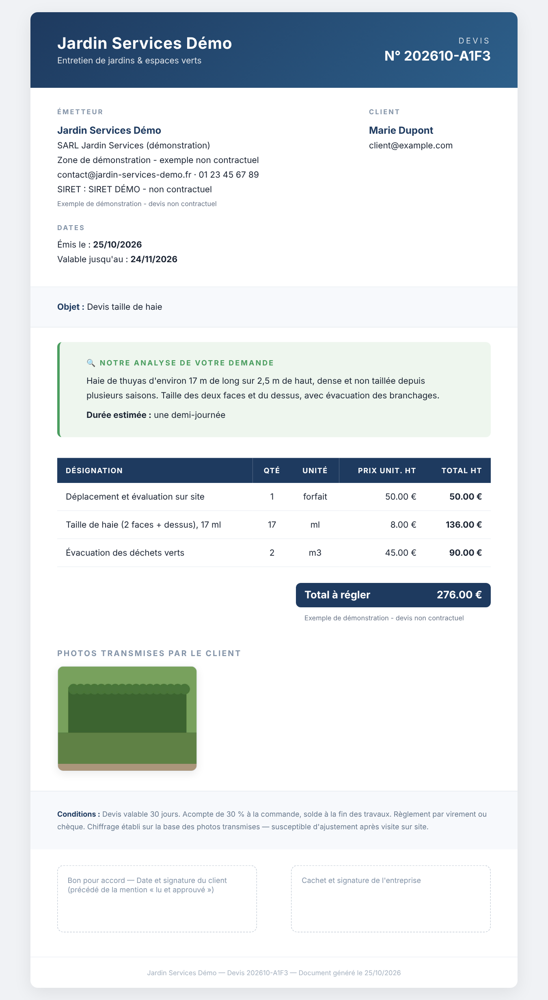

# Photo → Devis

[](https://github.com/stan-kempachi/photo-devis/actions/workflows/ci.yml)


Un client envoie une photo par email, il reçoit un devis en retour — sans intervention humaine.



Boucle de traitement qui tourne sur un Raspberry Pi 5 :

```
Email + photo (Gmail IMAP, polling 60 s)
        │
        ▼
Analyse de la photo par IA (Claude, vision) → description du besoin, lignes chiffrées selon un barème
        │
        ▼
Génération du devis numéroté (PDF, avec repli HTML)
        │
        ▼
Envoi par email (SMTP, IPv4 forcé + TLS), devis en pièce jointe
```

Projet de démonstration : l'entreprise fictive « Jardin Services Démo » (entretien de jardins) ; les coordonnées se changent par variables d'environnement.

## Stack

- Python 3.12+ ; le cœur (IMAP, SMTP, appel API, HTML) n'utilise que la **bibliothèque standard**
- Dépendances optionnelles : `fpdf2` (devis PDF) et `pillow` (compression des photos) — sans elles le service tourne en mode dégradé (HTML, photos brutes)
- API Anthropic (Claude) pour l'analyse de la photo
- systemd pour le service, redémarrage automatique, notification en cas d'échec
- Variante n8n : workflows `workflows/*.json` (webhook → génération → envoi)

## Installation

```bash
git clone https://github.com/stan-kempachi/photo-devis.git /opt/photo-devis
cd /opt/photo-devis
pip install -r requirements.txt   # fpdf2 + pillow (optionnel)
cp .env.example .env               # GMAIL_ADDRESS, GMAIL_APP_PASSWORD (mot de passe d'application), ENTREPRISE_*
chmod 600 .env
export ANTHROPIC_API_KEY=...       # ou dans .env

python3 scripts/photo_to_devis_production.py   # test en premier plan
```

Service :

```bash
sudo cp photo-devis.service /etc/systemd/system/
sudo systemctl enable --now photo-devis
journalctl -u photo-devis -f
```

Guides détaillés : [`docs/SETUP_FR.md`](docs/SETUP_FR.md) · [`docs/SECURITY_FR.md`](docs/SECURITY_FR.md) (versions anglaises à côté).

## Développement

```bash
pip install -r requirements-dev.txt
pytest -q            # 23 tests, API et SMTP simulés — aucun appel réseau
ruff check . && ruff format --check .
```

## Sécurité

- Aucun identifiant dans le code : tout passe par `.env` (ignoré par git) ou l'environnement du service
- Mot de passe d'application Gmail, jamais le mot de passe du compte
- Les devis générés (`devis_outputs/`) et l'état de traitement restent locaux
- Le contenu des emails est échappé avant insertion dans le devis HTML

## Structure

```
photo_devis/
  config.py       paramètres (variables d'environnement), coordonnées, barème
  mail.py         lecture IMAP, décodage des messages, pièces jointes, envoi SMTP
  ia.py           appel à Claude (vision), analyse du JSON renvoyé
  devis.py        construction du devis (lignes, totaux, numéro), écriture des fichiers
  rendu_html.py   gabarit HTML
  rendu_pdf.py    rendu PDF (fpdf2)
  state.py        état local : messages traités, dernier UID IMAP
  main.py         boucle de polling
scripts/photo_to_devis_production.py   point d'entrée du service systemd
tests/                                 tests unitaires (pytest)
workflows/                             variantes n8n (email-to-devis, photo-to-devis)
docs/                                  installation et sécurité (FR/EN), capture d'exemple
photo-devis.service                    unité systemd
.env.example                           variables attendues
```

## Licence

Code publié à titre de portfolio. Tous droits réservés — voir [`LICENSE`](LICENSE).
